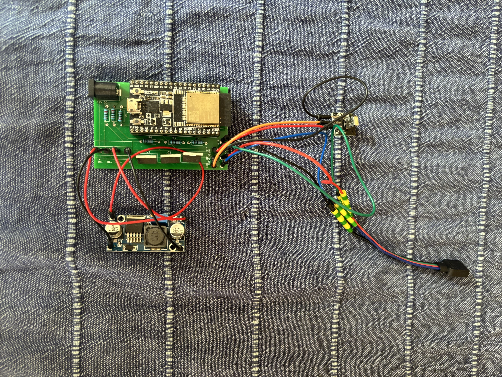
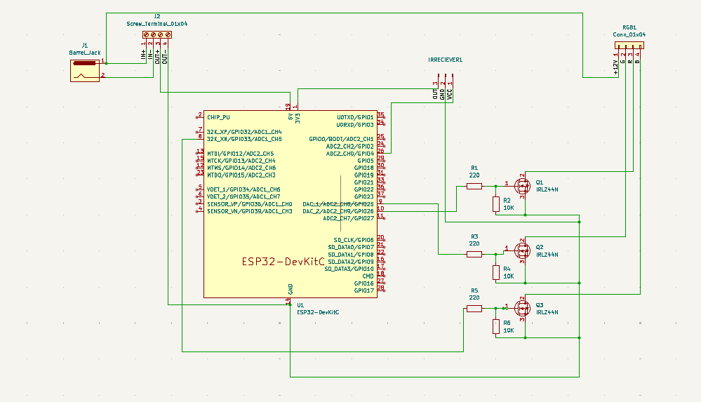
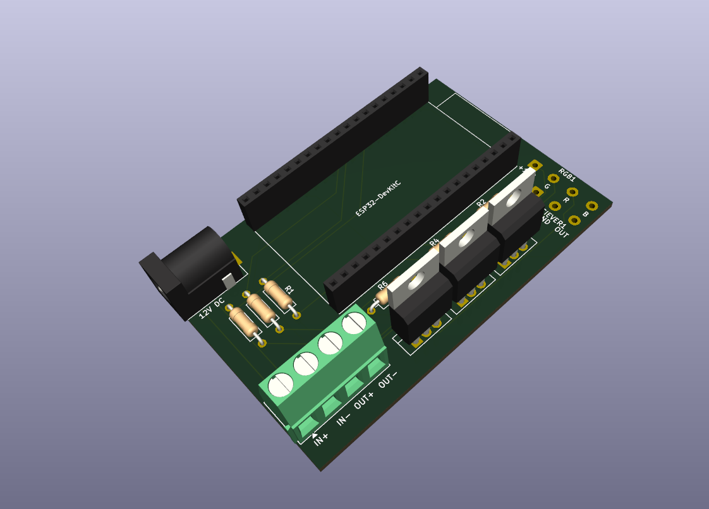
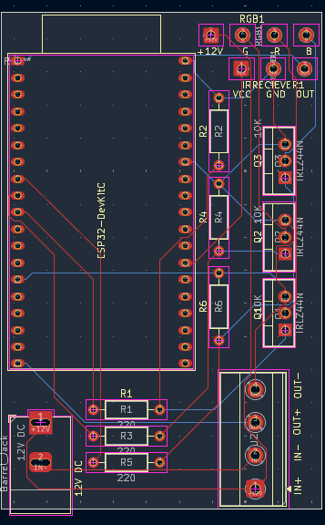

# ESP32 WLED RGB LED Controller

A simple controller board for **12V analog RGB LED strips** (non-addressable, common anode), built around an **ESP32 DevKitC** running **[WLED](https://kno.wled.ge/)**. It supports Wi-Fi control from the WLED app/web UI and an **IR remote** via an onboard IR receiver header.

| Assembled board | Schematic | PCB render |
|---|---|---|
|  |  |  |



## Features

- Controls 12V RGB LED strips (3 PWM channels)
- ESP32 DevKitC socketed on female headers (easy to replace/reflash)
- Logic-level MOSFETs (IRLZ44N) driven directly from 3.3V GPIO
- IR receiver input for standard 24/44-key RGB remotes
- Single 12V DC input (barrel jack); 5V for the ESP32 from an external LM2596 buck module
- Designed in KiCad

## Hardware

| Ref | Part | Notes |
|-----|------|-------|
| U1 | ESP32 DevKitC | Powered through the 5V pin |
| Q1–Q3 | IRLZ44N | Low-side switches, one per color |
| R1, R3, R5 | 220 Ω | Gate series resistors |
| R2, R4, R6 | 10 kΩ | Gate pull-downs (LEDs stay off during boot) |
| J1 | DC barrel jack | 12V input |
| J2 | 4-pin screw terminal | Connection to LM2596 module (IN+, IN−, OUT+, OUT−) |
| RGB1 | 4 solder-wire pads | +12V, G, R, B to the LED strip |
| IRRECEIVER1 | 3 solder-wire pads | VCC (3.3V), GND, OUT |
| — | LM2596 buck module | **Set output to 5V before connecting the ESP32!** |
| — | IR receiver module | e.g. VS1838B / KY-022 |

Full bill of materials: [`docs/proiectv2.csv`](docs/proiectv2.csv).

> The ESP32 footprint comes from the **Espressif KiCad library** (`PCM_Espressif`). Install it from KiCad's Plugin and Content Manager before opening the PCB.

## Pinout

| Function | ESP32 GPIO |
|----------|------------|
| Q1 (PWM) | GPIO25 |
| Q2 (PWM) | GPIO26 |
| Q3 (PWM) | GPIO33 |
| IR receiver | GPIO4 |

> Check which MOSFET drives which color on your strip and set the color order in WLED accordingly.

## WLED Configuration

1. Flash WLED to the ESP32 using the [WLED web installer](https://install.wled.me/).
2. Connect to the `WLED-AP` access point and set up your Wi-Fi.
3. Go to **Config → LED Preferences**:
   - LED type: **PWM RGB**
   - Pins: **25, 26, 33** (in R, G, B order according to your wiring)
4. Go to **Config → Sync Interfaces → Infrared**:
   - IR GPIO: **4**
   - Select your remote type (24-key, 44-key, etc.)
5. Save and reboot.

## Assembly Notes

- **Adjust the LM2596 output to 5.0V with a multimeter before plugging in the ESP32.**
- Do not power the ESP32 from USB and the 5V rail at the same time.
- Use thick wire (≥0.5 mm²) for the +12V and color channels to the LED strip.
- Without heatsinks, keep the load to roughly **3A per channel** (IRLZ44N at 3.3V gate drive).

## Known Issues (Rev 1)

- **Ground return path:** the LED current returns to the barrel jack through the LM2596 module's ground (OUT− → IN−). Fix on existing boards: solder a thick wire from the barrel jack GND pin directly to the MOSFET sources.
- **Power traces are too narrow** for high-current strips. Reinforce them with solder or copper wire.

## Planned for Rev 2

- [ ] Direct ground connection from J1 to the power ground
- [ ] Ground pour on the bottom layer
- [ ] Wider power traces (≥2 mm) for +12V and MOSFET drain/source
- [ ] Bulk capacitor (100–470 µF) on the 12V rail
- [ ] Input fuse and reverse polarity protection
- [ ] Optional onboard 5V regulator

## Repository Structure

```
├── hardware/
│   ├── proiectv2.kicad_pro      KiCad project
│   ├── proiectv2.kicad_sch      Schematic
│   └── proiectv2.kicad_pcb      PCB layout
├── gerbers/                     Gerber + drill files, ready for fabrication
├── docs/
│   └── proiectv2.csv            Bill of materials
├── images/                      Photos, schematic, PCB layout and 3D render
├── LICENSE
└── README.md
```

To order the board, zip the contents of `gerbers/` and upload the archive to any PCB manufacturer (JLCPCB, PCBWay, etc.). 2-layer, 1.6 mm, standard settings.

## License

This project is licensed under the **GNU General Public License v2.0**. See [LICENSE](LICENSE) for details.
